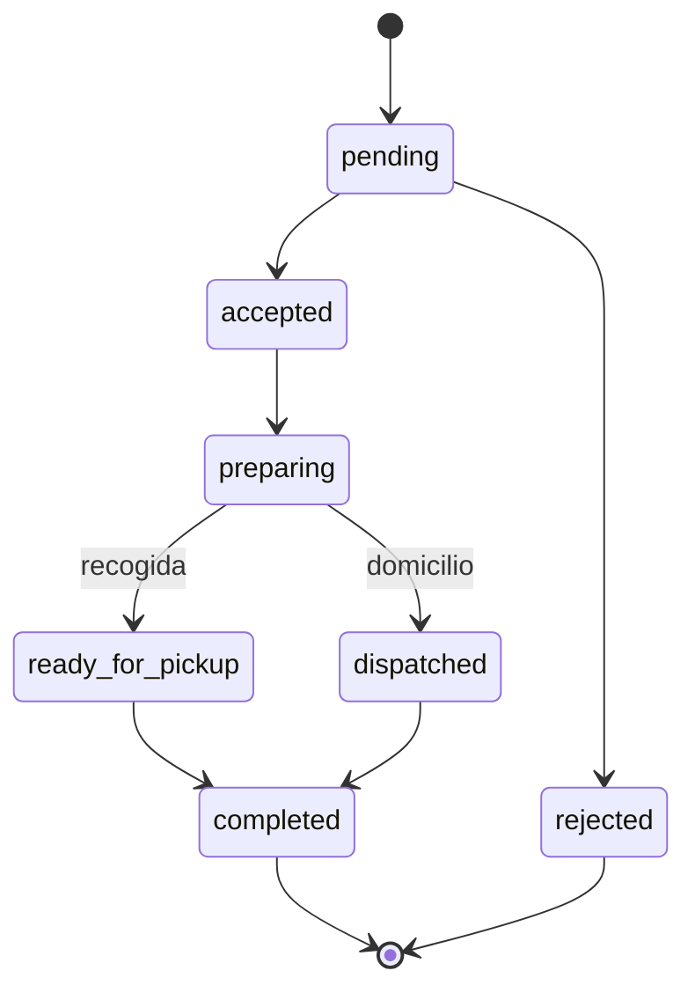

# ObraGo

**Materiales a tiempo. Obras que avanzan.**

ObraGo es una plataforma móvil de abastecimiento para el sector de la construcción. Conecta obras, contratistas y almacenistas con ferreterías: la persona busca un material, ve qué ferreterías lo ofrecen, compara precio, distancia y calificación, y envía el pedido **solo** a la ferretería que elige.

> Proyecto universitario en etapa de **Prueba de Concepto (PoC)**: backend funcional y primeras pantallas de la app.

## Problema que resuelve

Cuando el proveedor habitual de una obra no tiene un material, o se necesita con urgencia, hay que llamar o escribir por WhatsApp a varias ferreterías. Eso toma tiempo y puede dejar trabajadores y actividades detenidos. ObraGo centraliza la búsqueda y el pedido en un solo lugar, sin reemplazar la relación con los proveedores habituales: es una alternativa rápida cuando ese canal no responde.

## Estado del proyecto

| Parte | Estado |
|---|---|
| Backend (autenticación, base de datos, reglas de seguridad, servicios) | Listo |
| Pantallas: inicio de sesión, crear cuenta, inicio con búsqueda y categorías, resultados, perfil | Listas |
| Pantalla de pedidos del cliente | Pendiente |
| Panel de la ferretería (pedidos, productos, negocio) | Pendiente |
| Panel de administración | Pendiente |
| Notificaciones push y fotos de productos | Fase 2 |

## Tecnologías

- **React Native** y **Expo** (una sola base de código para Android, iOS y web)
- **TypeScript**
- **Firebase Authentication** (usuarios y roles)
- **Cloud Firestore** (base de datos NoSQL)
- **React Navigation** (navegación entre pantallas)
- **Git** y **GitHub**

## Arquitectura

```
App (React Native + Expo: Android / iOS / Web)
        │ usa
        ▼
Capa de servicios (src/services)  ← lógica de negocio
        │ habla con
        ▼
Firebase
  ├─ Authentication  → quién eres
  ├─ Firestore       → base de datos
  └─ Reglas          → qué puedes hacer (se ejecutan en el servidor)
```

El backend es *serverless*: no hay un servidor propio. La lógica vive en `src/services` y la seguridad en `firestore.rules`.

## Funcionalidades

**Roles:** cliente, ferretería y administrador.

- Registro e inicio de sesión
- Búsqueda de materiales por nombre o categoría
- Comparación de ferreterías por precio y calificación (la distancia se calcula cuando se conoce la ubicación del usuario)
- Pedido a una sola ferretería, con domicilio o recogida en tienda
- Seguimiento del estado del pedido en tiempo real
- Calificación de la ferretería después de un pedido finalizado
- Publicación de productos y precios por parte de cada ferretería, **sin manejo de inventario** (decisión del MVP)

### Estados del pedido



Solo la ferretería avanza el estado, y solo en este orden. Las reglas de seguridad lo validan en el servidor.

## Base de datos

Seis colecciones en Firestore. El diseño completo está en [`docs/BASE_DE_DATOS.md`](docs/BASE_DE_DATOS.md).

| Colección | Qué guarda |
|---|---|
| `users` | Perfil y rol de cada persona |
| `stores` | Ferreterías |
| `catalog` | Catálogo único de materiales |
| `storeProducts` | Qué vende cada ferretería y a qué precio |
| `orders` | Pedidos, con historial de estados |
| `reviews` | Calificaciones (una por pedido) |

## Estructura del repositorio

```
obrago/
├─ App.tsx                  Punto de entrada de la app
├─ docs/                    Documentación (instalación, base de datos, sustentación)
├─ scripts/
│  ├─ seed.ts               Carga datos de prueba en Firestore
│  ├─ seedData.ts           Datos de prueba
│  └─ demo.ts               Demo del flujo completo en consola
├─ src/
│  ├─ config/               Conexión a Firebase
│  ├─ constants/            Estados del pedido y categorías
│  ├─ types/                Modelos TypeScript
│  ├─ utils/                Texto, distancia, formato, errores
│  ├─ services/             Backend: auth, tiendas, productos, búsqueda, pedidos, reseñas
│  ├─ context/              Sesión del usuario
│  ├─ hooks/                Búsquedas recientes
│  ├─ components/           Logo, botones, campos de texto
│  ├─ navigation/           Rutas según el rol
│  └─ screens/              Pantallas
├─ firestore.rules          Reglas de seguridad
├─ firestore.indexes.json   Índices de consultas
└─ .env.example             Variables de Firebase (plantilla)
```

## Cómo ejecutarlo

Requisitos: **Node.js 20.6 o superior**, Git y una cuenta de Google para Firebase.

```bash
git clone https://github.com/Mailoo1/ObraGo.git
cd ObraGo
npm install
```

1. Crea un proyecto en [Firebase Console](https://console.firebase.google.com): activa **Authentication** (correo y contraseña) y crea **Firestore**.
2. Copia `.env.example` a `.env` y pega los valores de tu app web de Firebase.
3. Publica `firestore.rules` en la pestaña **Reglas** de Firestore.
4. Despliega los índices: `npx firebase-tools deploy --only firestore:indexes`.
5. Descarga una clave de cuenta de servicio, guárdala como `serviceAccountKey.json` en la raíz y carga datos de prueba:

```bash
npm run seed
npm run demo      # recorre el flujo completo y prueba la seguridad
```

6. Arranca la app:

```bash
npx expo start    # escanea el QR con Expo Go, o presiona "w" para la web
```

Instrucciones detalladas en [`docs/SETUP.md`](docs/SETUP.md).

### Usuarios de prueba

Creados por `npm run seed`. Contraseña de todos: `ObraGo123!`

| Rol | Correo |
|---|---|
| Cliente | `cliente@obrago.test` |
| Ferretería | `tienda1@obrago.test`, `tienda2@obrago.test`, `tienda3@obrago.test` |
| Administrador | `admin@obrago.test` |

Son solo datos de prueba. Para producción, usa un proyecto de Firebase distinto y empieza con la base vacía.

### Scripts

| Comando | Qué hace |
|---|---|
| `npm run seed` | Carga datos de prueba |
| `npm run demo` | Demo del flujo completo en consola |
| `npm run typecheck` | Revisa los tipos de TypeScript |

## Seguridad

- Nunca subas `.env` ni `serviceAccountKey.json`: están en `.gitignore`. La segunda es una llave de administrador de Firebase.
- Un pedido solo lo ven el cliente que lo hizo, la ferretería elegida y el administrador.
- Los precios del pedido se leen de la base de datos, no de lo que envíe la pantalla.
- Solo se puede calificar un pedido finalizado, una sola vez.

## Problemas comunes

- **Expo Go no conecta con el celular:** deben estar en el mismo Wi-Fi, con Node permitido en el firewall de Windows.
- **Metro se traba o da errores de archivos:** no guardes el proyecto dentro de OneDrive; muévelo a una carpeta como `C:\dev`.
- **`auth/operation-not-allowed`:** falta activar el método de correo y contraseña en Firebase Authentication.
- **`The query requires an index`:** despliega los índices o abre el enlace que trae el error.

## Limitaciones conocidas

- El promedio de calificaciones lo actualiza la propia app con reglas estrictas; en producción debería hacerlo una Cloud Function.
- No incluye pagos, inventario en tiempo real, domiciliarios propios ni notificaciones push (por ahora).
- La distancia a cada ferretería es aproximada, en línea recta.

## Próximos pasos

1. Pantalla de pedidos del cliente y flujo de envío de pedido.
2. Panel de la ferretería: recibir pedidos, cambiar estados, administrar productos.
3. Panel de administración para aprobar ferreterías.
4. Fotos de productos y notificaciones push.
5. Validar el problema con entrevistas a contratistas, almacenistas y ferreterías.
6. Integración con **Control Obra**: el pedido ya trae los campos `obraId` y `obraName` para enlazarlo con una obra.

## Autor

Proyecto de [TU NOMBRE] · [NOMBRE DE LA UNIVERSIDAD] · [MATERIA] · 2026

Prototipo de diseño en Figma: [PEGA AQUÍ EL LINK]
